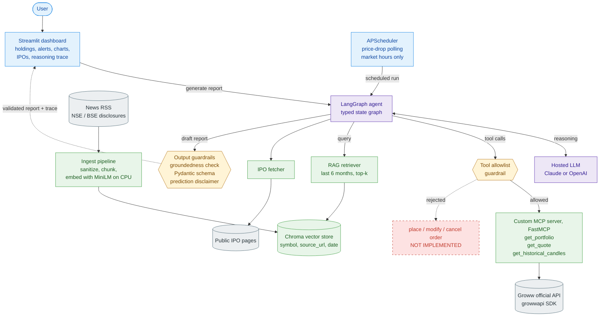
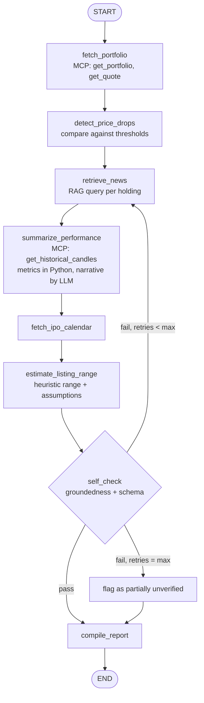
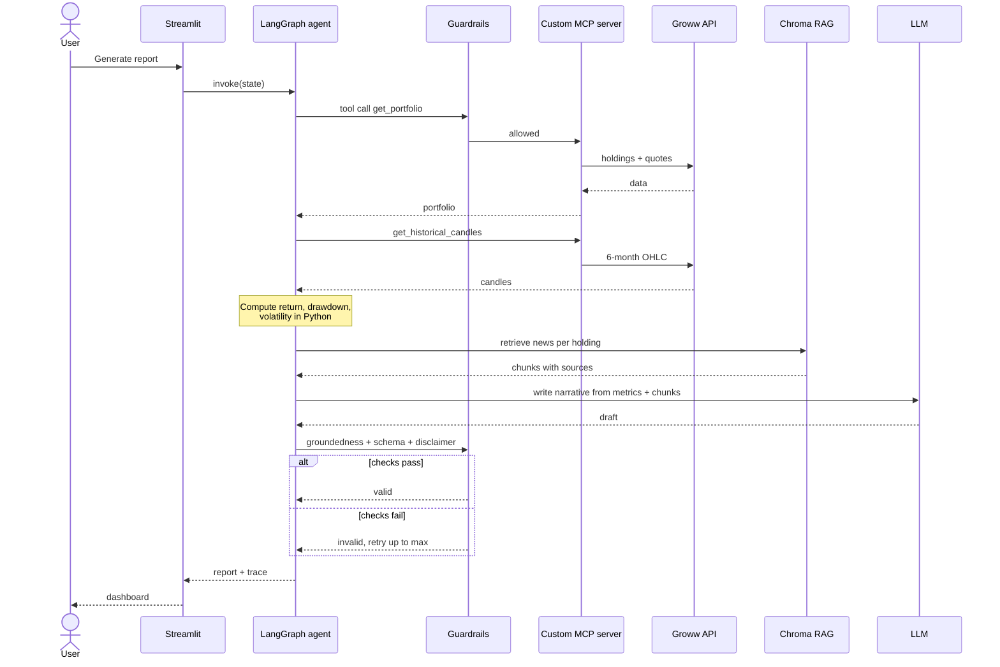

# Stock Recommendation System — Portfolio Pulse

An AI agent that monitors a Groww brokerage portfolio and produces grounded, explainable reports: price-drop alerts, 6-month company performance summaries, and IPO updates with clearly labeled listing-price estimates.

Built with **LangGraph**, a **custom MCP server** over the official Groww API, **RAG**, **guardrails**, and a **Streamlit** dashboard.

> **Status:** Work in progress. See the [Roadmap](#roadmap).

> **Disclaimer:** This project is for educational and informational purposes only. Nothing it produces is financial advice. All predictions are illustrative estimates with stated assumptions, not guarantees.

---

## Features

- **Portfolio overview:** live holdings, quantities, current prices and unrealized P&L.
- **Price-drop alerts:** configurable percentage or absolute thresholds per holding or across the portfolio.
- **6-month performance:** returns, max drawdown and volatility computed in Python, with a narrative grounded in retrieved news and filings.
- **IPO tracker:** upcoming and recent IPOs with price band, dates, subscription status and an estimated listing-price range.
- **Reasoning trace:** every report shows the tool calls, retrieved sources and guardrail decisions behind it.

### Read-only by design

The agent **cannot place, modify or cancel orders**. The custom MCP server only implements read-only tools, and a tool allowlist guardrail rejects any other tool call. There is no code path to trading.

---

## Architecture

### System architecture



**Legend:** blue = presentation and control, purple = orchestration, yellow = guardrails, green = tools and knowledge, grey = external read-only sources, red dashed = deliberately not implemented.

### Agent graph



### Request sequence



| Concept | How it's used |
|---|---|
| **MCP** | A self-built FastMCP server wraps the official `growwapi` SDK and exposes only `get_portfolio`, `get_quote` and `get_historical_candles`. No third-party MCP servers. |
| **RAG** | Company news and NSE/BSE disclosures are chunked, embedded and stored in Chroma with source and date metadata, so performance narratives cite real sources. |
| **LangGraph agent** | A typed state graph orchestrates data fetching, analysis, retrieval and report compilation, with conditional edges for retries. |
| **Tool calling** | MCP tools are loaded into the agent through `langchain-mcp-adapters`, with Pydantic-validated inputs and outputs. |
| **Guardrails** | A tool allowlist, a groundedness check (every number must trace to tool or computed data), Pydantic-structured reports and automatic disclaimers on predictions. |
| **Loop engineering** | A self-check loop regenerates or re-retrieves when grounding fails (capped iterations), plus a scheduled polling loop for price-drop monitoring. |
| **Streamlit** | Dashboard for holdings, alerts, charts, IPOs and the reasoning trace. |

---

## Tech stack

- Python 3.12
- [LangGraph](https://github.com/langchain-ai/langgraph) and [langchain-mcp-adapters](https://github.com/langchain-ai/langchain-mcp-adapters)
- [MCP Python SDK](https://github.com/modelcontextprotocol/python-sdk) (FastMCP)
- [growwapi](https://pypi.org/project/growwapi/), the official Groww SDK
- ChromaDB and sentence-transformers (`all-MiniLM-L6-v2`) for embeddings
- Streamlit
- Pydantic and APScheduler
- A hosted LLM (Anthropic Claude or OpenAI)

No GPU is required. Everything runs locally on CPU, and the LLM is called over an API.

---

## Project structure

```
StockRecommendationSystem/
├── mcp_server/
│   └── groww_server.py      # Read-only MCP tools over growwapi
├── agent/
│   ├── graph.py             # LangGraph state and nodes
│   └── guardrails.py        # Allowlist, groundedness, disclaimers
├── rag/
│   ├── ingest.py            # Fetch, chunk and embed news/filings
│   └── retriever.py
├── data/
│   └── ipo_fetcher.py       # IPO calendar source
├── scheduler/
│   └── monitor.py           # Price-drop polling loop
├── tests/
│   ├── test_config.py       # Settings loading and validation
│   └── test_environment.py  # Dependencies and modules import cleanly
├── app.py                   # Streamlit entry point
├── config.py                # Loads and validates settings from .env
├── requirements.txt
├── pytest.ini
├── .python-version          # Python 3.12
├── .env.example
├── motto.txt                # Full requirements and architecture
└── README.md
```

---

## Getting started

### Prerequisites

1. **Groww API access.** Generate an API key and secret from the Groww developer portal. Access tokens expire daily, and the MCP server handles refresh.
2. **LLM API key** from Anthropic or OpenAI.
3. **Python 3.12** and [uv](https://github.com/astral-sh/uv) (or pip).

### Installation

```bash
git clone https://github.com/BeastHarsha/StockRecommendationSystem.git
cd StockRecommendationSystem
uv venv --python 3.12 .venv
uv pip install --python .venv -r requirements.txt
```

Activate the environment:

```bash
# Windows (PowerShell)
.venv\Scripts\Activate.ps1

# macOS / Linux
source .venv/bin/activate
```

The first install takes a few minutes because `sentence-transformers` pulls in PyTorch (CPU build).

### Configuration

Copy `.env.example` to `.env` and fill in your values:

```bash
cp .env.example .env
```

| Variable | Default | Purpose |
|---|---|---|
| `GROWW_API_KEY` | | Groww API key. Not needed in mock mode. |
| `GROWW_API_SECRET` | | Groww API secret. Not needed in mock mode. |
| `ANTHROPIC_API_KEY` | | LLM API key |
| `LLM_MODEL` | `claude-sonnet-5-5` | Model used by the agent |
| `USE_MOCK_GROWW` | `true` | Use sample portfolio data instead of the Groww API |
| `PRICE_DROP_THRESHOLD_PCT` | `5` | Default price-drop alert threshold |
| `POLL_INTERVAL_MINUTES` | `15` | Price-drop polling cadence |
| `MAX_SELF_CHECK_RETRIES` | `3` | Cap on the self-check loop |
| `CHROMA_PERSIST_DIR` | `storage/chroma` | Where the vector store is saved |
| `EMBEDDING_MODEL` | `all-MiniLM-L6-v2` | Local embedding model for RAG |

`config.py` validates these at startup and reports any missing credentials. Never commit `.env`. Credentials are read from environment variables and are never logged or displayed.

### Run

```bash
streamlit run app.py
```

Open http://localhost:8501. Right now the dashboard shows setup status (data source, model, threshold and any missing credentials). The portfolio, alert, IPO and trace views are added phase by phase.

### Test

```bash
pytest
```

The tests check that settings load and validate correctly, and that every dependency and project module imports.

### Mock mode

Mock mode is on by default (`USE_MOCK_GROWW=true`), so you can develop without Groww API access. Once the MCP server lands, it returns sample portfolio data with the same tool signatures as the real API. Set it to `false` when your Groww credentials are ready.

---

## Guardrails in detail

| Guardrail | Type | Behavior |
|---|---|---|
| Tool allowlist | Pre-execution | Rejects any tool not in `{get_portfolio, get_quote, get_historical_candles}` |
| Content sanitization | Input | Strips instruction-like text from retrieved news to reduce prompt-injection risk |
| Groundedness check | Output | Every number in a narrative must match tool output or a Python-computed metric, or the report fails validation |
| Structured output | Output | Reports are validated against a Pydantic schema |
| Prediction disclaimer | Output | Any estimate is labeled as illustrative, with its range and assumptions |

---

## Roadmap

- [ ] **Phase 1:** Read-only MCP server, LangGraph skeleton and Streamlit portfolio view
- [ ] **Phase 2:** Price-drop alerts, guardrails and self-check loop
- [ ] **Phase 3:** RAG pipeline and grounded 6-month performance summaries
- [ ] **Phase 4:** IPO tracker and listing-price range estimation
- [ ] **Phase 5:** Reasoning trace panel, scheduling, tests and documentation

### Out of scope

- Order placement, modification or cancellation
- Personalized buy, sell or hold advice
- Multi-user support
- Tick-level real-time trading signals

---

## License

Licensed under the [Apache License 2.0](LICENSE).
