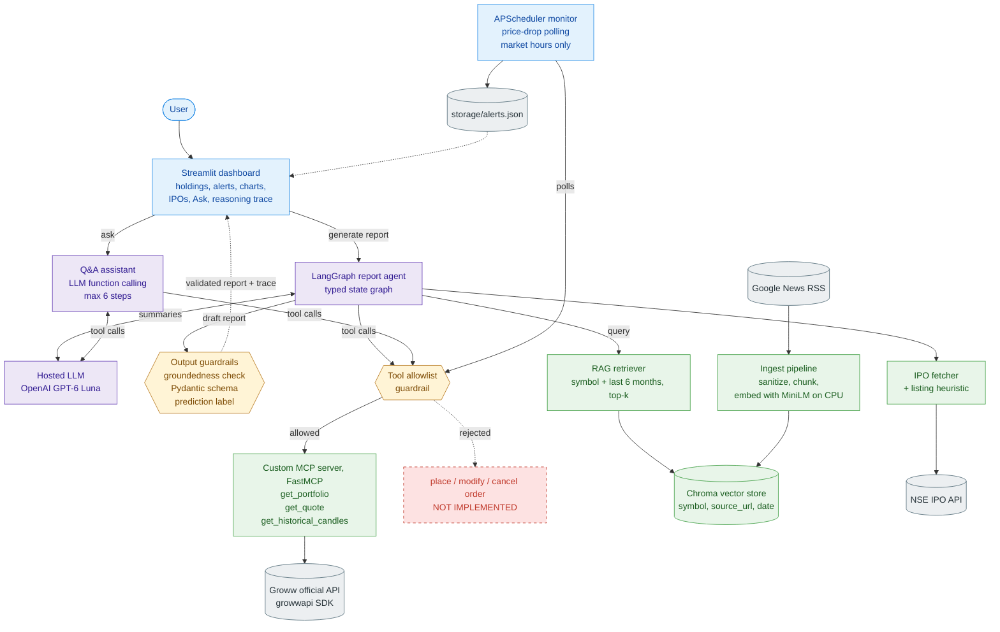
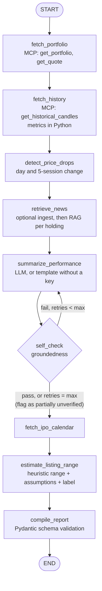
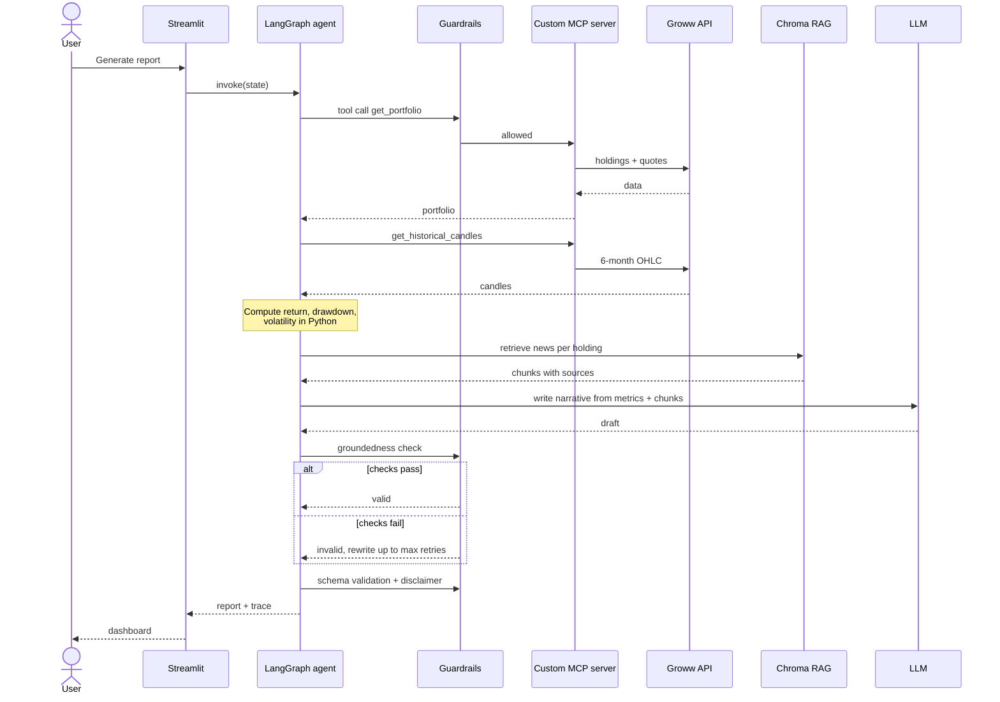

# Stock Recommendation System — Portfolio Pulse

An AI agent that monitors a Groww brokerage portfolio and produces grounded, explainable reports: price-drop alerts, 6-month company performance summaries, and IPO updates with clearly labeled listing-price estimates.

Built with **LangGraph**, a **custom MCP server** over the official Groww API, **RAG**, **guardrails**, **LLM function calling** and a **Streamlit** dashboard.

> **Disclaimer:** This project is for educational and informational purposes only. Nothing it produces is financial advice. All predictions are illustrative estimates with stated assumptions, not guarantees.

---

## Features

- **Portfolio overview:** holdings and quantities, with last prices and unrealised P&L when live quotes are available.
- **Price-drop alerts:** a percentage threshold checked against the day's change and the change over the last 5 sessions, both in reports and in a background monitor.
- **6-month performance:** return, max drawdown and annualised volatility computed in Python, a candlestick chart, and a narrative grounded in those numbers and in retrieved news.
- **IPO tracker:** current and upcoming NSE IPOs with price band, dates, subscription and an estimated listing range from a transparent heuristic.
- **Ask:** questions about the portfolio, answered by an LLM that calls the read-only tools itself.
- **Reasoning trace:** every report shows the agent steps, tool calls and guardrail verdicts behind it.
- **Works without API credits:** mock portfolio data by default, and template summaries when AI summaries are off or the model is unavailable.

### Read-only by design

The agent **cannot place, modify or cancel orders**:

1. The custom MCP server implements only `get_portfolio`, `get_quote` and `get_historical_candles`.
2. The client drops any other tool the server might expose before the agent sees it.
3. Every call is checked against the allowlist at run time. The tests prove an injected `place_order` tool is rejected at both points.

---

## Architecture

### System architecture



**Legend:** blue = presentation and control, purple = orchestration, yellow = guardrails, green = tools and knowledge, grey = external sources and storage, red dashed = deliberately not implemented.

### Agent graph



On a retry, only the failing summaries are rewritten, and the LLM is told exactly which numbers weren't grounded.

### Request sequence



| Concept | How it's used |
|---|---|
| **MCP** | A self-built FastMCP server (`mcp_server/groww_server.py`) wraps the official `growwapi` SDK and exposes three read-only tools. No third-party MCP servers. |
| **RAG** | Google News headlines per holding are sanitized, chunked, embedded locally and stored in Chroma with symbol, source and date metadata. Retrieval filters by symbol and the last 6 months. |
| **LangGraph agent** | `agent/graph.py`: a typed state graph of 9 nodes with a conditional retry edge. |
| **Tool / function calling** | MCP tools are loaded through `langchain-mcp-adapters`. The report agent calls them directly, and the Q&A assistant (`agent/assistant.py`) lets the LLM choose which tool to call. |
| **Guardrails** | `agent/guardrails.py`: tool allowlist, content sanitization, groundedness check, Pydantic schema validation and prediction labels. |
| **Loop engineering** | The self-check loop (capped by `MAX_SELF_CHECK_RETRIES`), the assistant's tool loop (capped at 6 steps) and the scheduled polling loop. |
| **Streamlit** | `app.py`: Portfolio, Alerts, Performance, IPOs, Ask and Trace tabs. |

---

## Tech stack

- Python 3.12
- [LangGraph](https://github.com/langchain-ai/langgraph) and [langchain-mcp-adapters](https://github.com/langchain-ai/langchain-mcp-adapters)
- [MCP Python SDK](https://github.com/modelcontextprotocol/python-sdk) 1.x (FastMCP). `langchain-mcp-adapters` 0.3.1 doesn't work with `mcp` 2.x, so `mcp` is pinned to 1.30.0.
- [growwapi](https://pypi.org/project/growwapi/), the official Groww SDK
- ChromaDB and sentence-transformers (`all-MiniLM-L6-v2`) for embeddings
- OpenAI GPT-6 Luna through `langchain-openai` and the Responses API (optional)
- Streamlit and Plotly, Pydantic, APScheduler

No GPU is required. Everything runs locally on CPU, and the LLM is called over an API.

---

## Project structure

```
StockRecommendationSystem/
├── mcp_server/
│   ├── groww_server.py      # Read-only MCP tools over growwapi (mock or live provider)
│   └── mock_data.py         # Deterministic sample portfolio with scripted price drops
├── agent/
│   ├── graph.py             # LangGraph report agent: state, nodes, retry loop
│   ├── assistant.py         # Q&A with LLM function calling and a capped tool loop
│   ├── guardrails.py        # Allowlist, sanitization, groundedness, disclaimers
│   ├── analysis.py          # P&L, 6-month metrics, price-drop detection (pure Python)
│   ├── schemas.py           # Pydantic report schema
│   └── mcp_client.py        # Starts the MCP server over stdio and loads its tools
├── rag/
│   ├── ingest.py            # Fetch, sanitize, chunk and embed news into Chroma
│   └── retriever.py         # Symbol- and date-filtered retrieval
├── data/
│   └── ipo_fetcher.py       # NSE IPO calendar and listing-range heuristic
├── scheduler/
│   └── monitor.py           # Price-drop polling loop and alert store
├── tests/                   # Unit, integration and environment tests
├── app.py                   # Streamlit dashboard
├── config.py                # Loads and validates settings from .env
├── requirements.txt         # Pinned versions
├── pytest.ini
├── .python-version          # Python 3.12
├── .env.example
├── motto.txt                # Full requirements and architecture
└── README.md
```

---

## Getting started

### Prerequisites

1. **Python 3.12** and [uv](https://github.com/astral-sh/uv) (or pip).
2. Optional: an **OpenAI API key** for LLM-written summaries and the Ask tab.
3. Optional: **Groww API access** to use your real portfolio. Provide either an access token or an API key and secret pair. Direct access tokens expire daily; API key and secret authentication requires daily approval in Groww Cloud. Live quotes and history also require market-data access.

### Installation

```bash
git clone https://github.com/BeastHarsha/StockRecommendationSystem.git
cd StockRecommendationSystem
uv venv --python 3.12 .venv
uv pip install --python .venv -r requirements.txt
```

Activate the environment:

```bash
# Windows (PowerShell)
.venv\Scripts\Activate.ps1

# macOS / Linux
source .venv/bin/activate
```

The first install takes a few minutes because `sentence-transformers` pulls in PyTorch (CPU build).

### Configuration

Copy `.env.example` to `.env` and fill in your values:

```bash
cp .env.example .env
```

| Variable | Default | Purpose |
|---|---|---|
| `GROWW_ACCESS_TOKEN` | | Direct Groww access token. Preferred when you have a generated token; refresh it daily. Not needed in mock mode. |
| `GROWW_API_KEY` | | Groww API key for the key and secret flow. Not needed when using an access token or mock mode. |
| `GROWW_API_SECRET` | | Matching Groww API secret. An access token does not belong in this field. |
| `OPENAI_API_KEY` | | LLM key. Without it, summaries use templates and Ask is disabled. |
| `LLM_MODEL` | `gpt-6-luna` | Model used for summaries and Ask |
| `USE_MOCK_GROWW` | `true` | Use sample portfolio data instead of the Groww API |
| `PRICE_DROP_THRESHOLD_PCT` | `5` | Price-drop alert threshold |
| `POLL_INTERVAL_MINUTES` | `15` | Monitor polling cadence |
| `MAX_SELF_CHECK_RETRIES` | `3` | Cap on the self-check loop |
| `CHROMA_PERSIST_DIR` | `storage/chroma` | Where the vector store is saved |
| `EMBEDDING_MODEL` | `all-MiniLM-L6-v2` | Local embedding model for RAG |

`config.py` validates these at startup and reports any missing credentials. Never commit `.env`. Credentials are read from environment variables and are never logged or displayed.

### Run the dashboard

```bash
streamlit run app.py
```

Open http://localhost:8501 and click **Generate report** in the sidebar. Options:

- **Ground summaries in news (RAG):** retrieve stored news for each holding. The first run downloads the embedding model (about 90 MB) and takes a minute or two.
- **Use AI summaries:** turn this off to generate template summaries without OpenAI API calls. If the API reports exhausted credits, the report makes no further model calls and uses templates for the remaining holdings.
- **Fetch fresh news first:** pull recent headlines from Google News into the vector store before the report.
- **IPO data:** live from NSE, sample data, or off.

### Run the price-drop monitor

```bash
python -m scheduler.monitor
```

This polls every `POLL_INTERVAL_MINUTES` during NSE market hours (09:15–15:30 IST, Monday to Friday; exchange holidays aren't modelled) and writes new alerts to `storage/alerts.json`, which the Alerts tab shows. You'll get at most one alert per holding, window and day. Use `--once` to poll a single time, and add `--force` to poll outside market hours.

### Other entry points

```bash
python -m rag.ingest                 # ingest news for every holding without generating a report
python -m mcp_server.groww_server    # run the MCP server on stdio, e.g. for MCP Inspector
```

### Mock mode

Mock mode is on by default (`USE_MOCK_GROWW=true`). The MCP server then serves a deterministic five-stock portfolio with the same tool signatures as the real API. It has scripted moves, so the alerts fire: INFY drops 6.2% on the day and ITC drops 7.5% over 5 sessions.

Mock prices are synthetic, but news is fetched live, so headlines will quote real prices that don't match the mock ones. Set `USE_MOCK_GROWW=false` once your Groww credentials are in `.env`.

### Test

```bash
pytest                    # 79 fast unit tests, about 15 seconds
pytest -m integration     # starts the real MCP server over stdio
pytest -m env             # checks every dependency imports (slow: PyTorch)
```

---

## Guardrails in detail

| Guardrail | Stage | Behavior |
|---|---|---|
| Tool allowlist | Load time and every call | Only `get_portfolio`, `get_quote` and `get_historical_candles` are loaded or callable. Anything else is dropped or blocked and logged. |
| Content sanitization | Before embedding | Strips HTML, removes role-tag blocks such as `<system>…</system>`, and drops instruction-like sentences ("ignore previous instructions", "you are now", ...) |
| Groundedness check | After each summary and each Ask answer | Every number must be a rounding of a tool value, a Python-computed metric or a number in a retrieved source. Small counts, days and years are exempt. Failing summaries are rewritten up to the retry cap, then flagged as partially unverified. |
| Schema validation | Before display | The report must validate against the Pydantic schema and carry the standard disclaimer. |
| Prediction label | IPO estimates | Every estimate must have an ordered range, its assumptions and the "Illustrative estimate, not financial advice" label, or validation fails. |

Prices and metrics are always computed in Python, never by the LLM. That's what makes the groundedness check simple and reliable.

---

## Known limitations

- If Groww allows holdings but denies live market data, the dashboard shows the holdings and invested amount, while current value, P&L and performance remain unavailable.
- The news corpus is Google News headlines, not full articles or exchange filings.
- The IPO listing range is a simple subscription-multiple heuristic, not a model. NSE doesn't publish price bands for BSE-listed SME issues, so those get no estimate.
- The monitor doesn't know about exchange holidays.
- One user and one portfolio.

### Out of scope

- Order placement, modification or cancellation
- Personalized buy, sell or hold advice
- Multi-user support
- Tick-level real-time trading signals

---

## License

Licensed under the [Apache License 2.0](LICENSE).
